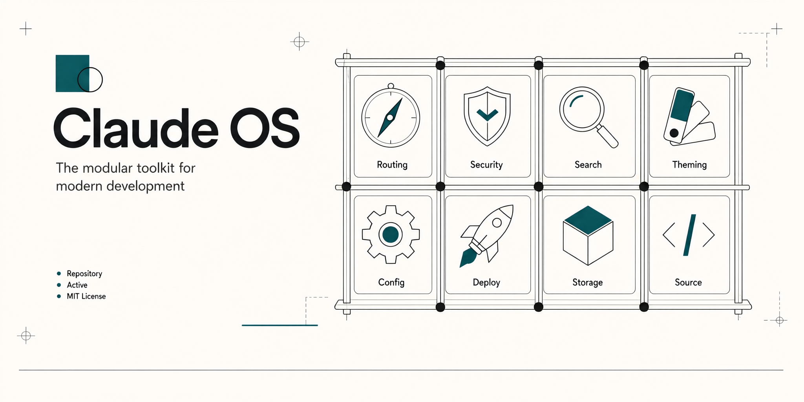
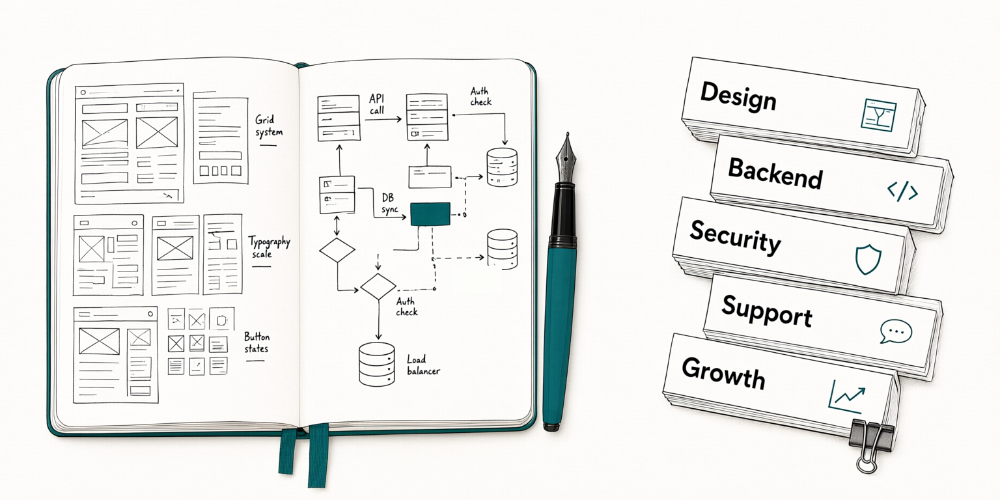

# Claude OS



**A personal AI engineering, design, product and growth operating system —
in a repository.** Clone it onto any machine, run one bootstrap, and
Claude Code is immediately ready to work at agency level: 29 specialist
agents, 36 original skills plus a library of 236 third-party skills,
15 gated workflows, persistent memory, a codebase
knowledge graph, a permission model with hard human gates, and the
scripts that make all of it reproducible.

```bash
git clone https://github.com/priyanshu-shroti01/claude-skills.git claude-os
cd claude-os
scripts/bootstrap.sh        # idempotent; --dry-run to preview
scripts/doctor.sh           # PASS/WARN/FAIL health report
scripts/install-pack.sh     # what to install, per tier (prints; --run to execute)
scripts/project-init.sh ~/work/my-site   # put any project on the OS
```

Or install it as a plugin, from inside Claude Code:

```
/plugin marketplace add priyanshu-shroti01/claude-skills
/plugin install claude-os@claude-os
```

The same marketplace carries the vetted external pack —
`no-ai-slop`, `superseo`, `mattpocock-selected`, `lets-scroll`. The plugin
deliberately ships **no hooks**: `scripts/bootstrap.sh` installs those, with
your consent. See [docs/skills/pack.md](docs/skills/pack.md).

Version: see [VERSION](VERSION) · Changes: [CHANGELOG.md](CHANGELOG.md) ·
License: [MIT](LICENSE) (external deps carry their own — see
[docs/dependencies.md](docs/dependencies.md)).

## What this is

Not an app. The **source of truth for a Claude Code environment**:
everything needed to reconstruct it — agents, skills, workflows, rules,
configs, installers, tests — is versioned here. No hidden local state.

| You want to… | Go to |
|---|---|
| Understand the architecture | [docs/architecture/overview.md](docs/architecture/overview.md) |
| Install on a new machine | [docs/installation/bootstrap.md](docs/installation/bootstrap.md) |
| Meet the agents | [AGENTS.md](AGENTS.md) · [docs/agents/README.md](docs/agents/README.md) |
| Browse the skills | [docs/skills/README.md](docs/skills/README.md) |
| The full pack (internal + external) | [docs/skills/pack.md](docs/skills/pack.md) |
| Visual reference sources | [references/design/inspiration-sources.md](references/design/inspiration-sources.md) |
| Run a workflow | [docs/workflows/README.md](docs/workflows/README.md) |
| Security model | [SECURITY.md](SECURITY.md) · [docs/security/README.md](docs/security/README.md) |
| Media generation | [docs/media/README.md](docs/media/README.md) |
| 3D & exploded views | [docs/3d/README.md](docs/3d/README.md) |
| 24/7 server operation | [docs/operations/README.md](docs/operations/README.md) |
| Dependency licenses/audit | [docs/dependencies.md](docs/dependencies.md) |
| Overlap rulings | [docs/architecture/skill-overlap.md](docs/architecture/skill-overlap.md) |

## Skills



36 original skills in 13 categories, written for real production work and
covered by this repo's MIT licence. Full index:
[docs/skills/README.md](docs/skills/README.md).

| Category | Skills |
|---|---|
| core | skill-router · quality-pipeline · memory · graph-knowledge |
| design | design-direction · anti-slop · design-review · cinematic-product-design · design-system |
| frontend | frontend-standards · component-quality |
| backend | api-standards · data-safety · whmcs-operations · payment-gateways · php-module-packaging |
| security | secure-coding · secrets-hygiene · webhook-security |
| support | support-playbook · cpanel-whm-guide |
| growth | growth-analysis · lead-research · launch-playbook |
| research | research-intelligence · competitor-analysis |
| qa | functional-qa · visual-qa |
| seo | technical-seo · geo |
| media | image-generation · video-generation |
| 3d | r3f-scenes · exploded-views |
| production | production-readiness · deployment-gates |

## Skill library


[`external/`](external/README.md) stores 236 third-party skills —
Anthropic's document and design skills, the claude-seo pack, Trail of Bits
security and fuzzing skills, the claude-flow agent skills and more — so any
project can pull in what it needs without hunting for them again.

```bash
# copy one skill into a project
cp -r external/seo-audit ~/work/my-site/.claude/skills/

# or several at once
for s in pdf xlsx accessibility; do cp -r external/$s ~/work/my-site/.claude/skills/; done
```

These keep their **upstream licences** (see the `LICENSE` inside each folder
where one exists) — they are not covered by this repo's MIT licence, are not
shipped in the plugin, and the skill-router only uses them once a project
adds them. The table in [external/README.md](external/README.md) lists what
each one does.

## Repository map

```
CLAUDE.md            operating charter (binding for Claude)
AGENTS.md            roster + hierarchy      DESIGN.md   design philosophy
SECURITY.md          security policy         PRODUCTION_READINESS.md  ship checklist
SYSTEM_MANIFEST.yaml versioned inventory (verify.sh cross-checks it)
.claude/             settings, agent definitions, hooks, rules, commands, skill links
agents/              29 extended charters    skills/     36 skills in 13 categories
external/            236 third-party skills, each under its own licence
workflows/           15 staged processes     references/ quick sheets (numbers live here)
integrations/        per-integration install/config docs
scripts/             bootstrap · install · doctor · verify · status · update ·
                     sync · project-init · uninstall (+ lib/common.sh)
config/              permissions (L0-L5) · mcp templates · providers ·
                     external-dep registry · environments
templates/           project/website/nextjs/react/backend starting points
tests/               the OS tests itself (run: tests/run-all.sh)
docs/                guides + architecture + decisions + dependency audit
```

## The operating model in 60 seconds

**Commander** decomposes goals and keeps the ledger → **Skill Router**
loads only the capabilities a task needs → specialists build inside
their charters → independent reviewers gate the work (code, security,
functional QA, visual QA, accessibility, SEO, performance,
**anti-slop**) → production-agent audits the ship checklist → **a human
approves every deployment** → learning-agent records lessons and
proposes system improvements as reviewed PRs.

Three rules carry most of the weight:

1. **Implementer never approves own work.**
2. **Levels 4–5 (staging/production) and all sensitive actions require
   explicit human approval — every time.** Backed by settings denials
   and a functionally-tested pre-tool hook, not just policy.
3. **"It builds" ≠ done.** The applicable gates pass, or it isn't
   finished — including the anti-slop gate: generic AI aesthetics are a
   defect.

## Daily commands

```bash
scripts/status.sh     # dashboard: version, inventory, integrations, health
scripts/doctor.sh     # PASS/WARN/FAIL diagnosis with fixes
scripts/verify.sh     # repo self-consistency (manifest ↔ files ↔ configs)
tests/run-all.sh      # full self-test suite
scripts/update.sh     # pull latest OS + relink + health check
scripts/sync.sh       # drift report: this machine vs. the manifest
```

Inside Claude Code: `/os-status`, `/doctor`, `/route <task>`,
`/quality-pipeline`, `/anti-slop`, `/production-check`,
`/research <brief>`, `/new-website <brief>`.

## Credentials

Copy `.env.example` → `.env` (gitignored) and fill only what you need.
Everything works without credentials except: media generation
(provider keys), analytics/Search Console ingestion, GitHub MCP, Figma
MCP, and deploy hooks. Secrets never enter git, memory, logs, or
docs — mechanically enforced where possible ([SECURITY.md](SECURITY.md)).

## Contributing / evolving

Feature branches → independent review → merge ([.claude/rules/git-rules.md](.claude/rules/git-rules.md)).
Every change keeps `scripts/verify.sh` and `tests/run-all.sh` green.
Version bumps touch `VERSION` + manifest + CHANGELOG together. Changes
to security rules, permissions, or hooks additionally require explicit
human approval — the learning-agent proposes, humans decide.

## Versioning

Semantic versioning. v0.x = development (current), v1.0 = stable
interface for agents/skills/workflow names and script CLIs.
